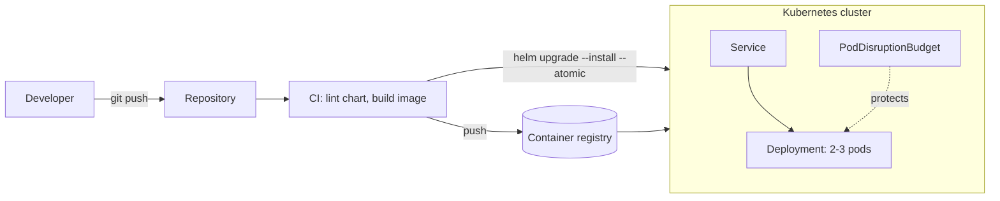

# Architecture

## Design decisions

| Decision | Why |
| --- | --- |
| `maxUnavailable: 0`, `maxSurge: 1` | A rolling update never drops below the desired replica count. |
| Readiness and liveness probes on `/healthz` | Readiness keeps traffic away from a pod that is not ready; liveness restarts a hung one. |
| Non-root user, read-only root filesystem, all capabilities dropped | Least privilege inside the container. |
| One chart, per-environment values files | Environments differ in data, not in templates. |
| `--atomic` on deploy | A failed release rolls itself back instead of staying half-deployed. |
| PodDisruptionBudget in prod | Node drains cannot take the service below one available pod. |
